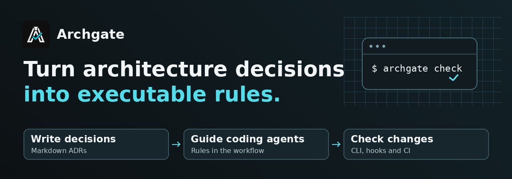

# Archgate



**Enterprise-grade linting and guardrails for AI work.** Archgate turns your team's architecture decisions into executable checks. Coding agents can read your rules before they write code, and `archgate check` verifies changes locally, in pre-commit hooks, or in CI.

## Try it

```bash
curl -fsSL https://cli.archgate.dev/install-unix | sh
archgate init
archgate check
```

## Start here

| Repository | What it does |
| --- | --- |
| [CLI](https://github.com/archgate/cli) | Write Architecture Decision Records (ADRs) and run automated checks. |
| [ADR library](https://github.com/archgate/awesome-adrs) | Import ready-to-use ADRs into your project. |
| [Setup Action](https://github.com/archgate/setup-action) | Install the Archgate CLI in GitHub Actions. |
| [Check Action](https://github.com/archgate/check-action) | Run architecture checks in GitHub Actions. |
| [Studies](https://github.com/archgate/studies) | Explore reproducible governance studies and their methodology. |

[Website](https://archgate.dev) · [Documentation](https://docs.archgate.dev) · [Community](https://www.reddit.com/r/archgatedev)
